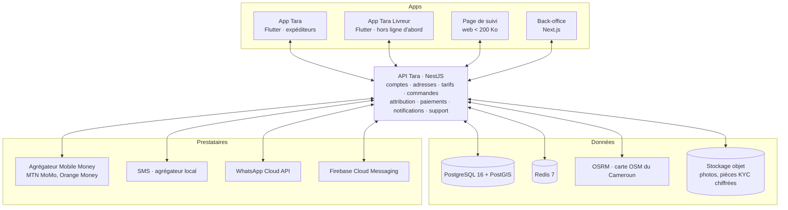
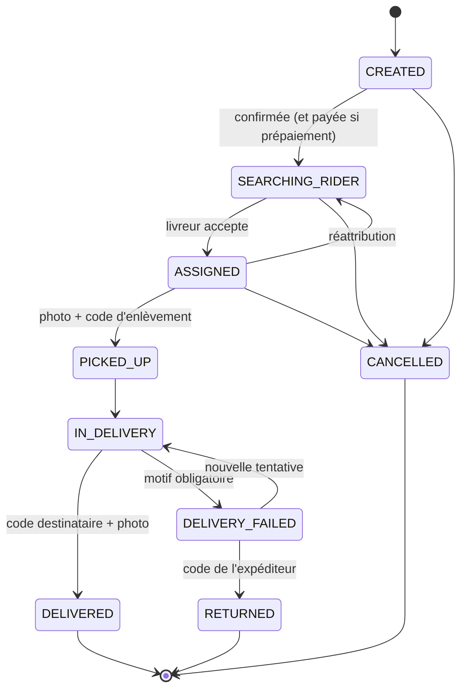

# Architecture de Tara

Un seul back-end (monolithe modulaire NestJS) sert les quatre applications. Il s'appuie sur
PostgreSQL + PostGIS pour les données et l'argent, et sur Redis pour le temps réel. Chaque
prestataire externe est branché derrière une interface.



## Structure du dépôt

```text
tara-platform/
├── apps/
│   ├── api/                 NestJS 12 (ESM) + Prisma 7 — phases 0 à 3
│   │   ├── prisma/          schéma et migrations
│   │   ├── src/             code applicatif (src/generated : client Prisma, non versionné)
│   │   └── test/            tests d'intégration contre PostgreSQL (*.db-spec.ts)
│   ├── rider/               app livreur Flutter — phase 4
│   ├── client/              app expéditeur Flutter — phase 5
│   ├── tracking/            page de suivi web — phase 5
│   └── backoffice/          back-office Next.js — phase 6
├── packages/                code partagé (client d'API généré, à partir de la phase 1)
├── infra/
│   ├── docker-compose.yml   PostgreSQL + PostGIS, Redis, OSRM (optionnel)
│   ├── postgres/init/       scripts exécutés à la création du volume
│   └── osrm/prepare.sh      préparation des itinéraires du Cameroun
├── docs/                    cahier des charges, architecture, plan des phases
└── .github/workflows/ci.yml intégration continue
```

## Versions retenues

| Outil                | Version  | Remarque                                                                                                                |
| -------------------- | -------- | ----------------------------------------------------------------------------------------------------------------------- |
| Node.js              | 22 LTS   | `.nvmrc`                                                                                                                |
| pnpm                 | 10.28    | Workspaces ; Turborepo 2.11 orchestre les tâches                                                                        |
| TypeScript           | 6.0      | La 7.0 (compilateur natif) n'est pas encore prise en charge par tout l'outillage ; 6.0 est celle que NestJS 12 installe |
| NestJS               | 12       | Modules ES, Vitest et oxlint par défaut                                                                                 |
| Prisma               | 7.10     | Client généré dans `src/generated`, connexion via `@prisma/adapter-pg`, configuration dans `prisma.config.ts`           |
| PostgreSQL / PostGIS | 16 / 3.4 | Image `postgis/postgis:16-3.4`                                                                                          |
| Redis                | 7        | Positions des livreurs et files de tâches, à partir de la phase 2                                                       |
| OSRM                 | 6.0.0    | Image `ghcr.io/project-osrm/osrm-backend`                                                                               |

## Décisions de conception

1. **Monolithe modulaire.** Un seul service à déployer et à déboguer pour une équipe de deux ou
   trois développeurs. Les modules communiquent par des services injectés, jamais par la base
   d'un autre module ; un module pourra être extrait plus tard si la charge l'exige.
2. **Identifiants UUID v7.** Uniques sans coordination et triés dans le temps, ce qui garde les
   index compacts.
3. **Argent en FCFA entiers.** Colonnes `Int` (jusqu'à 2,1 milliards de FCFA par ligne). Aucun
   nombre à virgule. Les pourcentages sont stockés en points de base (8000 = 80 %).
4. **Grand livre en double entrée, protégé en base.** Chaque écriture compte au moins deux lignes
   dont la somme est nulle (montant signé : positif = débit, négatif = crédit). Le contrôle est un
   trigger différé, vérifié à la validation de la transaction. Les tables `journal_entries` et
   `ledger_postings` sont en ajout seul : une erreur se corrige par une écriture inverse. Les soldes
   ne sont pas stockés : ils se calculent par somme des lignes, et ne peuvent donc pas diverger.
5. **Coordonnées.** L'application écrit `latitude` et `longitude` ; un trigger calcule la colonne
   PostGIS `location`, indexée en GiST. Les requêtes spatiales (zones, proximité, repères) sont
   écrites en SQL brut dans des repositories dédiés. Les polygones de zones sont importés en
   GeoJSON par SQL brut.
6. **Prix figé à la création.** La commande garde distance, prix de base, suppléments, remises,
   part livreur et part Tara. Contraintes en base : `total = base + suppléments − remises` et
   `part livreur + part Tara = total`. La part Tara peut être négative quand Tara finance une
   promotion (par exemple, une livraison offerte à 500 FCFA).
7. **Codes hachés.** Les codes SMS de connexion et les codes d'enlèvement et de livraison ne sont
   jamais stockés en clair. Un code perdu est régénéré, pas relu.
8. **Idempotence partout.** Clé unique `idempotency_key` sur paiements, reversements et écritures ;
   `client_event_id` unique sur les événements envoyés par l'app livreur hors ligne ; unicité
   `(provider, event_id)` sur les webhooks. Rejouer un appel ne crée jamais de doublon.
9. **Historique et audit en ajout seul.** `order_events` et `audit_logs` ne peuvent être ni
   modifiés ni supprimés. Le journal d'audit n'a pas de clé étrangère vers `users`, pour survivre à
   l'anonymisation d'un compte (`users.deleted_at`, loi n° 2024/017).
10. **Prestataires derrière des interfaces** (`PaymentProvider`, `SmsProvider`, `WhatsAppProvider`,
    `PushProvider`, `StorageProvider`), chacune avec une implémentation factice pour le
    développement et les tests. Elles arrivent avec les phases qui en ont besoin.
11. **Nommage.** Identifiants de code en anglais ; tables et colonnes en snake_case ;
    documentation, commentaires et messages d'erreur en français.

12. **Zod, source unique des contrats.** Chaque entrée est validée par un schéma Zod, et les
    mêmes schémas produisent le contrat OpenAPI versionné (`apps/api/openapi.json`) dont on génère
    le client Flutter. La CI échoue si le contrat n'est pas à jour.
13. **Connexion sans mot de passe.** Code SMS à 6 chiffres haché, 5 essais ; jeton d'accès JWT de
    15 minutes ; jeton de rafraîchissement opaque à usage unique, dont la réutilisation ferme
    toutes les sessions. L'utilisateur est relu en base à chaque requête : une suspension prend
    effet immédiatement.
14. **Prix toujours recalculé côté serveur.** Le calcul est une fonction pure testée
    (`pricing.engine.ts`). Les grilles sont versionnées : en activer une archive la précédente,
    et chaque commande garde la grille qui l'a tarifée. Distance par OSRM, avec repli sur une
    estimation à vol d'oiseau × 1,3 si OSRM ne répond pas en 2,5 s.
15. **Fichiers rattachés à leur propriétaire.** Une adresse ne peut référencer que les photos de
    son auteur ; le type réel des images et PDF est vérifié. Les pièces d'identité sont chiffrées
    (AES-256-GCM) et chaque consultation par l'équipe est auditée.
16. **Provisoire en phase 1** : SMS factice (journal), stockage sur disque, limitation de débit en
    mémoire, langue des SMS au destinataire en français. Remplacés par l'agrégateur SMS et Redis
    (phase 2) puis par un stockage objet (phase 7) ; la configuration refuse de démarrer en
    production tant que c'est le cas.

17. **Sécurité en profondeur.** Détail des menaces, des protections et des procédures dans
    [`SECURITE.md`](SECURITE.md) : second facteur obligatoire pour l'équipe, plafonds anti-pompage
    de SMS, compte de base restreint, minimisation des données, journaux masqués.

## Cycle de vie d'une commande

Statuts définis dans le schéma ; les transitions seront implémentées et testées en phase 1.



## Plan de comptes proposé (à valider en phase 3)

| Code                             | Type    | Sens                                                     |
| -------------------------------- | ------- | -------------------------------------------------------- |
| `platform:mobile_money`          | Actif   | Argent détenu chez l'agrégateur Mobile Money             |
| `rider:<id>:cash_held`           | Actif   | Espèces encaissées par le livreur et pas encore déposées |
| `merchant:<id>:payable`          | Passif  | Encaissements dus au marchand                            |
| `rider:<id>:payable`             | Passif  | Gains dus au livreur                                     |
| `platform:revenue:commission`    | Produit | Commission de 20 % sur les livraisons                    |
| `platform:revenue:cod_fees`      | Produit | Frais d'encaissement (2 %, minimum 250 FCFA)             |
| `platform:expense:provider_fees` | Charge  | Frais Mobile Money                                       |
| `platform:expense:promotions`    | Charge  | Remises financées par Tara                               |

## Développement local

Prérequis : Node 22, pnpm 10, Docker.

```bash
pnpm install
pnpm infra:up                         # PostgreSQL + PostGIS, Redis
cp apps/api/.env.example apps/api/.env
pnpm db:migrate                       # applique les migrations
pnpm dev                              # API sur http://localhost:3000/health
```

| Commande         | Rôle                                        |
| ---------------- | ------------------------------------------- |
| `pnpm lint`      | oxlint avec règles typées                   |
| `pnpm typecheck` | Vérification TypeScript stricte             |
| `pnpm test`      | Tests unitaires (sans base)                 |
| `pnpm test:db`   | Tests d'intégration contre PostgreSQL migré |
| `pnpm format`    | Formatage Prettier                          |
| `pnpm db:studio` | Explorateur de données Prisma               |

## Questions ouvertes

| Sujet                                          | Options                                                                                            | Quand trancher  |
| ---------------------------------------------- | -------------------------------------------------------------------------------------------------- | --------------- |
| Agrégateur Mobile Money                        | Comparer les devis de 3 agrégateurs camerounais (frais de collecte et de reversement, API, délais) | Avant phase 3   |
| Montage de l'encaissement pour compte de tiers | Avis juridique sur la réglementation CEMAC des services de paiement                                | Avant phase 3   |
| Hébergement et région                          | Avis juridique sur les transferts de données (loi n° 2024/017)                                     | Avant phase 7   |
| Profil d'itinéraire moto                       | Profil « car » d'OSRM au départ ; profil moto sur mesure si les délais estimés s'écartent du réel  | Après le pilote |
