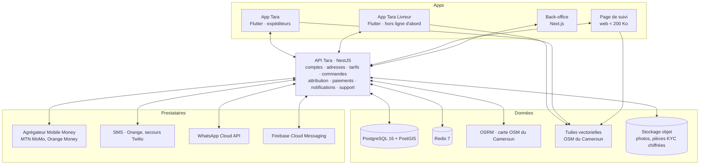
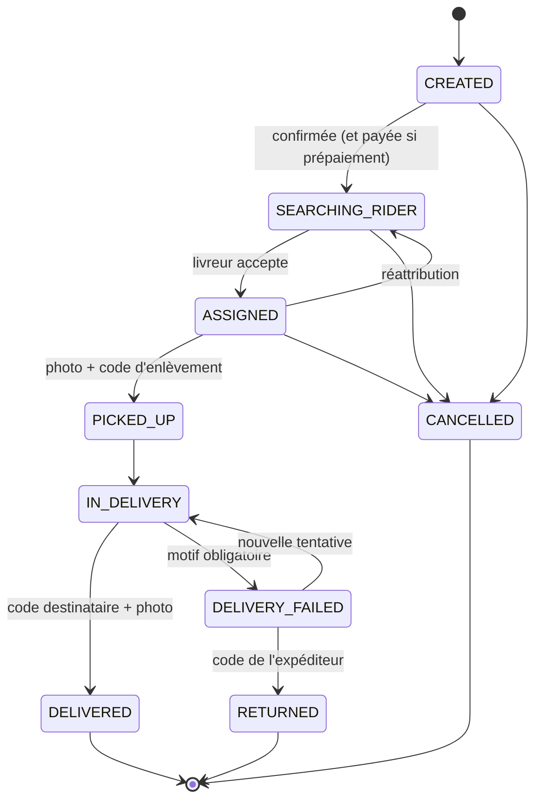

# Architecture de Tara

Un seul back-end (monolithe modulaire NestJS) sert les quatre applications. Il s'appuie sur
PostgreSQL + PostGIS pour les données et l'argent, et sur Redis pour le temps réel. Chaque
prestataire externe est branché derrière une interface.



## Structure du dépôt

```text
tara-platform/
├── apps/
│   ├── api/                 NestJS 12 (ESM) + Prisma 7 — phases 0 à 3
│   │   ├── prisma/          schéma et migrations
│   │   ├── src/             code applicatif (src/generated : client Prisma, non versionné)
│   │   └── test/            tests d'intégration contre PostgreSQL (*.db-spec.ts)
│   ├── rider/               app livreur Flutter — phase 4
│   ├── client/              app expéditeur Flutter — phase 5
│   ├── tracking/            page de suivi web — phase 5
│   └── backoffice/          back-office Next.js — phase 6
├── packages/                code partagé (client d'API généré, à partir de la phase 1)
├── infra/
│   ├── docker-compose.yml   PostgreSQL + PostGIS, Redis, OSRM (optionnel)
│   ├── postgres/init/       scripts exécutés à la création du volume
│   └── osrm/prepare.sh      préparation des itinéraires du Cameroun
├── docs/                    cahier des charges, architecture, plan des phases
└── .github/workflows/ci.yml intégration continue
```

## Versions retenues

| Outil                | Version              | Remarque                                                                                                                |
| -------------------- | -------------------- | ----------------------------------------------------------------------------------------------------------------------- |
| Node.js              | 22 LTS               | `.nvmrc`                                                                                                                |
| pnpm                 | 10.28                | Workspaces ; Turborepo 2.11 orchestre les tâches                                                                        |
| TypeScript           | 6.0                  | La 7.0 (compilateur natif) n'est pas encore prise en charge par tout l'outillage ; 6.0 est celle que NestJS 12 installe |
| NestJS               | 12                   | Modules ES, Vitest et oxlint par défaut                                                                                 |
| Prisma               | 7.10                 | Client généré dans `src/generated`, connexion via `@prisma/adapter-pg`, configuration dans `prisma.config.ts`           |
| PostgreSQL / PostGIS | 16 / 3.4             | Image `postgis/postgis:16-3.4`                                                                                          |
| Redis                | 7                    | Positions des livreurs (GEO), files BullMQ, Socket.IO entre instances, limitation de débit                              |
| OSRM                 | 6.0.0                | Image `ghcr.io/project-osrm/osrm-backend`                                                                               |
| Flutter / Dart       | 3.47 / 3.13          | App livreur `apps/rider` ; version épinglée en CI (les captures de référence en dépendent)                              |
| MapLibre             | Native (via Flutter) | Rendu des tuiles vectorielles, styles Tara sombre et clair, régions hors connexion                                      |

## Décisions de conception

1. **Monolithe modulaire.** Un seul service à déployer et à déboguer pour une équipe de deux ou
   trois développeurs. Les modules communiquent par des services injectés, jamais par la base
   d'un autre module ; un module pourra être extrait plus tard si la charge l'exige.
2. **Identifiants UUID v7.** Uniques sans coordination et triés dans le temps, ce qui garde les
   index compacts.
3. **Argent en FCFA entiers.** Colonnes `Int` (jusqu'à 2,1 milliards de FCFA par ligne). Aucun
   nombre à virgule. Les pourcentages sont stockés en points de base (8000 = 80 %).
4. **Grand livre en double entrée, protégé en base.** Chaque écriture compte au moins deux lignes
   dont la somme est nulle (montant signé : positif = débit, négatif = crédit). Le contrôle est un
   trigger différé, vérifié à la validation de la transaction. Les tables `journal_entries` et
   `ledger_postings` sont en ajout seul : une erreur se corrige par une écriture inverse. Les soldes
   ne sont pas stockés : ils se calculent par somme des lignes, et ne peuvent donc pas diverger.
5. **Coordonnées.** L'application écrit `latitude` et `longitude` ; un trigger calcule la colonne
   PostGIS `location`, indexée en GiST. Les requêtes spatiales (zones, proximité, repères) sont
   écrites en SQL brut dans des repositories dédiés. Les polygones de zones sont importés en
   GeoJSON par SQL brut.
6. **Prix figé à la création.** La commande garde distance, prix de base, suppléments, remises,
   part livreur et part Tara. Contraintes en base : `total = base + suppléments − remises` et
   `part livreur + part Tara = total`. La part Tara peut être négative quand Tara finance une
   promotion (par exemple, une livraison offerte à 500 FCFA).
7. **Codes hachés.** Les codes SMS de connexion et les codes d'enlèvement et de livraison ne sont
   jamais stockés en clair. Un code perdu est régénéré, pas relu.
8. **Idempotence partout.** Clé unique `idempotency_key` sur paiements, reversements et écritures ;
   `client_event_id` unique sur les événements envoyés par l'app livreur hors ligne ; unicité
   `(provider, event_id)` sur les webhooks. Rejouer un appel ne crée jamais de doublon.
9. **Historique et audit en ajout seul.** `order_events` et `audit_logs` ne peuvent être ni
   modifiés ni supprimés. Le journal d'audit n'a pas de clé étrangère vers `users`, pour survivre à
   l'anonymisation d'un compte (`users.deleted_at`, loi n° 2024/017).
10. **Prestataires derrière des interfaces** (`PaymentProvider`, `SmsProvider`, `WhatsAppProvider`,
    `PushProvider`, `StorageProvider`), chacune avec une implémentation factice pour le
    développement et les tests. Elles arrivent avec les phases qui en ont besoin.
11. **Nommage.** Identifiants de code en anglais ; tables et colonnes en snake_case ;
    documentation, commentaires et messages d'erreur en français.

12. **Zod, source unique des contrats.** Chaque entrée est validée par un schéma Zod, et les
    mêmes schémas produisent le contrat OpenAPI versionné (`apps/api/openapi.json`) dont on génère
    le client Flutter. La CI échoue si le contrat n'est pas à jour.
13. **Connexion sans mot de passe.** Code SMS à 6 chiffres haché, 5 essais ; jeton d'accès JWT de
    15 minutes ; jeton de rafraîchissement opaque à usage unique, dont la réutilisation ferme
    toutes les sessions. L'utilisateur est relu en base à chaque requête : une suspension prend
    effet immédiatement.
14. **Prix toujours recalculé côté serveur.** Le calcul est une fonction pure testée
    (`pricing.engine.ts`). Les grilles sont versionnées : en activer une archive la précédente,
    et chaque commande garde la grille qui l'a tarifée. Distance par OSRM, avec repli sur une
    estimation à vol d'oiseau × 1,3 si OSRM ne répond pas en 2,5 s.
15. **Fichiers rattachés à leur propriétaire.** Une adresse ne peut référencer que les photos de
    son auteur ; le type réel des images et PDF est vérifié. Les pièces d'identité sont chiffrées
    (AES-256-GCM) et chaque consultation par l'équipe est auditée.
16. **SMS sans point unique de défaillance.** Orange Cameroun (API officielle « SMS Cameroon »,
    tous opérateurs, prix locaux en FCFA, nom d'expéditeur validé par Orange) en principal ;
    Twilio en secours, utilisé automatiquement si Orange échoue (panne, solde épuisé). La
    connexion par code SMS ne dépend donc d'aucun fournisseur unique. Le volume quotidien est
    compté et l'équipe alertée à 80 % puis 100 % d'un seuil. Restent provisoires : stockage sur
    disque jusqu'au stockage objet (phase 7), langue des messages au destinataire en français.
    La configuration refuse de démarrer en production avec un fournisseur factice.

17. **Sécurité en profondeur.** Détail des menaces, des protections et des procédures dans
    [`SECURITE.md`](SECURITE.md) : second facteur obligatoire pour l'équipe, plafonds anti-pompage
    de SMS, compte de base restreint, minimisation des données, journaux masqués.
18. **Événements après validation.** Tout changement de statut passe par
    `OrderTransitionsService` puis est publié sur `OrderEventsBus` une fois la transaction
    validée : attribution, temps réel et notifications s'y abonnent sans dépendre les uns des
    autres, et ne voient jamais un changement annulé. Un abonné en échec ne bloque pas l'action.
19. **Attribution par tours, sous verrou.** Chaque tour d'attribution d'une commande s'exécute
    sous un verrou PostgreSQL propre à la commande (`pg_advisory_xact_lock`) : expiration d'une
    offre, refus et acceptation ne se croisent pas, même sur plusieurs instances. Un index unique
    partiel garantit une seule offre en attente par livreur. Les échéances passent par des tâches
    différées BullMQ ; un balayage toutes les 15 s rattrape ce qu'une panne aurait laissé.
20. **Positions hors de PostgreSQL.** Les positions (toutes les 10 à 15 s) ne vont que dans Redis :
    index GEO des livreurs en ligne, dernière position avec durée de vie. Seules les positions
    des preuves (enlèvement, livraison, échec) et des alertes sont gardées en base.
21. **Temps réel sans état.** Socket.IO avec l'adaptateur Redis : n'importe quelle instance peut
    émettre vers n'importe quel client. Les événements rafraîchissent les écrans ; l'API REST
    reste la référence (rien n'est perdu si un événement l'est).
22. **Notifications tracées et rejouables.** Chaque message est une ligne de `notifications`
    (statut, fournisseur, essais, repli). Les envois passent par une file (3 essais) ; un code de
    livraison n'y figure que chiffré, et seulement le temps d'un éventuel repli SMS.
23. **Argent dans la transaction du statut.** Les écritures d'une commande sont passées par
    `OrderTransitionHooks`, dans la transaction qui change son statut : statut et argent
    changent ensemble ou pas du tout. Une livraison est refusée tant que l'encaissement dû n'est
    pas fait, même forcée par le back-office.
24. **Paiements Mobile Money derrière `PaymentProvider`.** Prestataire factice capable de simuler
    les incidents (refus, notification perdue ou répétée, réponse perdue après un envoi) et
    adaptateur CamPay. Une notification n'est crue qu'après vérification de sa signature, n'est
    traitée qu'une fois, et son montant doit être celui demandé ; un paiement confirmé après son
    abandon est tout de même enregistré.
25. **Aucun reversement en double.** Une seule demande en cours par bénéficiaire (index unique),
    montant retiré du portefeuille sous verrou à la demande, passage « en cours → envoyé »
    conditionnel. Si la réponse du prestataire se perd, on lui redemande le statut par notre
    référence ; on ne renvoie que s'il n'a jamais reçu la demande. Au-delà d'un seuil, la finance
    valide avant l'envoi.
26. **Rapprochement chaque nuit.** Grand livre, paiements, reversements, relevé du prestataire et
    contre-remboursements comparés pour la veille ; écarts listés et alerte à la finance.
27. **Cartographie maîtrisée.** Comme les grands acteurs du transport, Tara a sa propre pile
    cartographique, assemblée à partir de briques ouvertes plutôt que louée : extrait
    OpenStreetMap du Cameroun (Geofabrik), tuiles vectorielles générées chaque mois (Planetiler,
    fichier PMTiles servi par Martin derrière le CDN), rendu MapLibre avec nos styles sombre et
    clair, OSRM pour les distances et les itinéraires. Ni clé ni facturation à l'usage ; les
    zones de travail du livreur restent lisibles hors connexion. Seule la navigation pas à pas
    part vers Google Maps ou Waze, par un simple lien.
28. **App livreur : un socle visuel unique.** Couleurs des deux thèmes dans une
    `ThemeExtension`, polices embarquées, un seul `Ticker` par écran pour le décor, mode effets
    réduits (sans flou, formes figées) sur les téléphones de 3 Go de RAM ou moins, arrêt des
    animations décoratives si le téléphone le demande. Chaque écran a ses captures de référence
    (deux thèmes, 390 × 844 et 360 × 640, texte à 100 % et 130 %) vérifiées en CI.

29. **App livreur : hors connexion d'abord.** Les actions de course (enlèvement, encaissement
    en espèces, livraison, échec, retour) passent par une file persistante dans le stockage
    chiffré du téléphone : ordre et heure réelle conservés, identifiant `clientEventId` qui
    rend tout renvoi sans effet, photo envoyée une seule fois, et une action refusée ne bloque
    que sa propre course. La file repart au retour du réseau, au retour dans l'app et toutes
    les 30 s. Le temps réel accélère l'affichage ; l'API REST reste la référence.
30. **Position du livreur.** En ligne, une position toutes les 10 s (le serveur le considère
    hors ligne après 90 s sans nouvelles), par le temps réel ou à défaut en HTTP. Android
    garde une notification permanente (service au premier plan de type « position ») : pas
    d'autorisation de localisation « toujours ». Hors ligne, aucune position n'est envoyée.
31. **Carte gardée malgré son poids.** Le moteur MapLibre ajoute 10,8 Mo à l'app installée
    (APK arm64 : 18,6 → 30,2 Mo) mais seulement 3,7 Mo au téléchargement (≈ 13 Mo au total,
    le Play Store compressant ce qu'il envoie). Choix validé : garder notre carte, et mesurer
    le poids au téléchargement (25 Mo au plus) et une fois installée (32 Mo au plus). La CI
    contrôle les deux sur les APK ARM (`tool/apk_report.py`). Google Maps aurait allégé l'app
    de 11 Mo, mais au prix d'une clé tierce, sans carte hors connexion ni maîtrise des styles.
32. **Trajet des courses enregistré.** Sécurité du livreur et des colis, preuves en cas de
    litige, détection des fraudes : chaque position reçue pendant une course (de
    l'acceptation à la fin, jamais en dehors) est gardée, un point toutes les ~10 s ; les
    positions prises sans réseau arrivent en lot au retour du réseau. Les points ne sont
    jamais modifiés (droit retiré au compte de l'API) et sont effacés après 90 jours, sauf
    litige ou incident ouvert ; le résumé reste avec la commande. Consultation par l'équipe
    seulement (support, dispatch, administrateur), chaque consultation tracée. Alertes au
    support : action validée loin de l'adresse, long arrêt avec le colis, position simulée,
    trajet coupé.
33. **Alerte SOS en deux volets.** Équipe Tara : maintien de 3 s (contre les appuis par
    erreur), l'alerte part avec la position, sa précision et le quartier ; les agents
    d'astreinte (SMS avec nom, plaque, quartier et lien carte) et le contact d'urgence sont
    prévenus, un agent rappelle, le livreur suit la prise en charge en direct. Sans data,
    l'alerte reste sur le téléphone et repart sans doublon au retour du réseau ; un SMS
    pré-rempli vers la ligne Tara part en un geste (pas d'envoi automatique : la permission
    d'envoyer des SMS est très encadrée par Google Play). Police : le livreur appelle le 117 depuis
    l'écran (pompiers 118 et SAMU 119 en cas d'accident ; Android ouvre le téléphone avec le
    numéro tapé, sans data ni crédit). S'il ne peut pas appeler (injoignable, danger
    confirmé), l'agent appelle la police avec la position en direct et la plaque ; l'heure,
    l'agent et ce qui a été dit restent avec l'alerte, action tracée. Rien n'est envoyé à la
    police automatiquement : pas de canal officiel, et les fausses alertes nuiraient à la
    crédibilité de Tara. Numéros d'urgence réglables côté serveur.
34. **Échec de livraison : preuve d'appel et décision bornée.** Client absent, injoignable
    ou adresse introuvable : 2 appels au destinataire passés depuis l'app, à 5 min d'écart
    au moins ; autre motif : 1 appel et une explication ; colis ou paiement refusé : aucun
    (le client est sur place). L'app note l'heure de chaque appel et sa durée approchée
    (temps passé hors de l'app ; le téléphone ne dit pas si l'appel a abouti, et lire le
    journal d'appels demanderait une permission refusée par Google Play) ; le serveur
    vérifie les règles. Après l'échec, l'expéditeur choisit nouvelle tentative ou retour ; le
    support peut choisir à sa place (action tracée) ; sans décision après 15 min, retour
    automatique : le livreur n'attend jamais plus longtemps avec le colis. Règles et délai
    réglables côté serveur.
35. **Espèces encaissées : dépôt sous 24 h (remplacé par la décision 36, gardé pour les espèces encore dues).** Le livreur dépose ses espèces sous 24 h
    (Mobile Money ou bureau) ; l'échéance se calcule sur le grand livre, les dépôts soldant
    d'abord les espèces les plus anciennes. Rappel à 18 h. En retard : plus de courses ni de
    passage en ligne jusqu'au dépôt, plafond ramené à 25 000 FCFA. Après 72 h de retard :
    compte suspendu, gains dus retenus sur la dette (écriture `CASH_COMPENSATED`), équipe
    prévenue par SMS avec les coordonnées du garant exigé à l'inscription ; la suspension
    est levée par la finance, une plainte reste la décision tracée d'un administrateur.
    Plafond de départ 25 000 FCFA, 50 000 FCFA après 20 courses livrées sans retard.
36. **Solde prépayé du livreur (comme les chauffeurs Yango).** Pour qu'un livreur ne puisse
    jamais garder l'argent d'un marchand, sans garant ni recouvrement : son solde (gains et
    recharges) couvre l'argent qu'il encaisse. À l'acceptation d'une course avec
    encaissement, le montant est mis de côté sur son solde (refusée s'il ne le couvre pas,
    comptes verrouillés contre deux acceptations simultanées) ; à l'encaissement en espèces,
    il est pris sur le solde : le livreur garde les espèces, le marchand est crédité aussitôt.
    Le solde ne devient jamais négatif. Recharge par Mobile Money (frais payés par Tara) ou au
    bureau ; les gains des courses déjà payées l'alimentent. Garant facultatif, sa CNI n'est
    plus exigée. Une course
    dont le destinataire paiera peut-être par Mobile Money est aussi couverte (on ne le sait
    qu'à la porte) : la réservation est libérée à la fin sans rien prendre.

## Cycle de vie d'une commande

Statuts définis dans le schéma ; les transitions seront implémentées et testées en phase 1.



## Plan de comptes

Montant positif = débit, négatif = crédit. Les soldes se calculent toujours à partir des lignes.

| Code                             | Type    | Sens                                                                   |
| -------------------------------- | ------- | ---------------------------------------------------------------------- |
| `platform:mobile_money`          | Actif   | Argent détenu chez l'agrégateur Mobile Money                           |
| `platform:office_cash`           | Actif   | Espèces déposées au bureau                                             |
| `rider:<id>:cash_held`           | Actif   | Espèces encaissées par le livreur et pas encore déposées (dues à Tara) |
| `platform:orders_prepaid`        | Passif  | Frais de livraison payés, course pas encore terminée                   |
| `platform:payouts_in_transit`    | Passif  | Reversements demandés, pas encore confirmés                            |
| `platform:unallocated`           | Passif  | Paiements reçus sans emploi, à rembourser ou affecter                  |
| `merchant:<id>:payable`          | Passif  | Portefeuille du marchand (encaissements nets, avoirs)                  |
| `rider:<id>:payable`             | Passif  | Gains dus au livreur                                                   |
| `customer:<id>:wallet`           | Passif  | Solde Tara d'un client (recharges, avoirs)                             |
| `platform:revenue:commission`    | Produit | Commission sur les livraisons                                          |
| `platform:revenue:cod_fees`      | Produit | Frais d'encaissement (2 %, minimum 250 FCFA)                           |
| `platform:expense:provider_fees` | Charge  | Frais Mobile Money                                                     |
| `platform:expense:promotions`    | Charge  | Remises financées par Tara                                             |
| `platform:expense:goodwill`      | Charge  | Avoirs commerciaux                                                     |

### Écritures d'une commande

| Moment                              | Écriture                                                                                                                              |
| ----------------------------------- | ------------------------------------------------------------------------------------------------------------------------------------- |
| Prépaiement Mobile Money            | Mobile Money ↑ / livraisons payées ↑                                                                                                  |
| Prépaiement par le solde            | Solde de l'expéditeur ↓ / livraisons payées ↑                                                                                         |
| Frais en espèces à l'enlèvement     | Espèces du livreur ↑ / livraisons payées ↑                                                                                            |
| Encaissement à la porte             | Espèces du livreur ou Mobile Money ↑ / livraisons payées ↑ (frais du destinataire), marchand ↑ (COD − frais), frais d'encaissement ↑  |
| Livraison ou retour                 | Livraisons payées ↓ / gains du livreur ↑, commission ↑ (ou promotions ↓) ; puis le livreur garde sa part sur les espèces de la course |
| Annulation après prépaiement        | Livraisons payées ↓ / solde de l'expéditeur ↑ (avoir)                                                                                 |
| Retour non payé par le destinataire | Solde de l'expéditeur ↓ (au besoin négatif) / livraisons payées ↑                                                                     |
| Reversement demandé, envoyé, échoué | Portefeuille ↓ / en cours ↑ ; puis en cours ↓ / Mobile Money ↓ ; ou en cours ↓ / portefeuille ↑                                       |

## Développement local

Prérequis : Node 22, pnpm 10, Docker.

```bash
pnpm install
pnpm infra:up                         # PostgreSQL + PostGIS, Redis
cp apps/api/.env.example apps/api/.env
pnpm db:migrate                       # applique les migrations
pnpm dev                              # API sur http://localhost:3000/health
```

| Commande                           | Rôle                                            |
| ---------------------------------- | ----------------------------------------------- |
| `pnpm lint`                        | oxlint avec règles typées                       |
| `pnpm typecheck`                   | Vérification TypeScript stricte                 |
| `pnpm test`                        | Tests unitaires (sans base)                     |
| `pnpm test:db`                     | Tests d'intégration contre PostgreSQL migré     |
| `pnpm --filter @tara/api simulate` | Simulateur d'attribution (50 livreurs virtuels) |
| `pnpm format`                      | Formatage Prettier                              |
| `pnpm db:studio`                   | Explorateur de données Prisma                   |

## Questions ouvertes

| Sujet                                          | Options                                                                                                                                                            | Quand trancher       |
| ---------------------------------------------- | ------------------------------------------------------------------------------------------------------------------------------------------------------------------ | -------------------- |
| Agrégateur Mobile Money                        | Adaptateur CamPay prêt (à valider sur son bac à sable) ; comparer les devis d'au moins 2 autres agrégateurs avant de signer                                        | Avant le pilote      |
| Montage de l'encaissement pour compte de tiers | Avis juridique sur la réglementation CEMAC des services de paiement                                                                                                | Avant le pilote      |
| Hébergement et région                          | Avis juridique sur les transferts de données (loi n° 2024/017)                                                                                                     | Avant phase 7        |
| Déclarations Google Play                       | Service au premier plan « position » et données de localisation à déclarer dans la Play Console (formulaire et courte vidéo)                                       | Avant la publication |
| Notifications FCM                              | Jeton classique utilisé ; passer à l'identifiant d'installation (nouvelle API Firebase) quand l'envoi côté serveur aura été adapté et vérifié                      | Après le pilote      |
| Information des livreurs sur le trajet         | Mention du trajet enregistré dans les conditions d'utilisation livreur et la déclaration du traitement à l'APDP (finalités, 90 jours, accès de l'équipe seulement) | Avant le pilote      |
| Profil d'itinéraire moto                       | Profil « car » d'OSRM au départ ; profil moto sur mesure si les délais estimés s'écartent du réel                                                                  | Après le pilote      |
